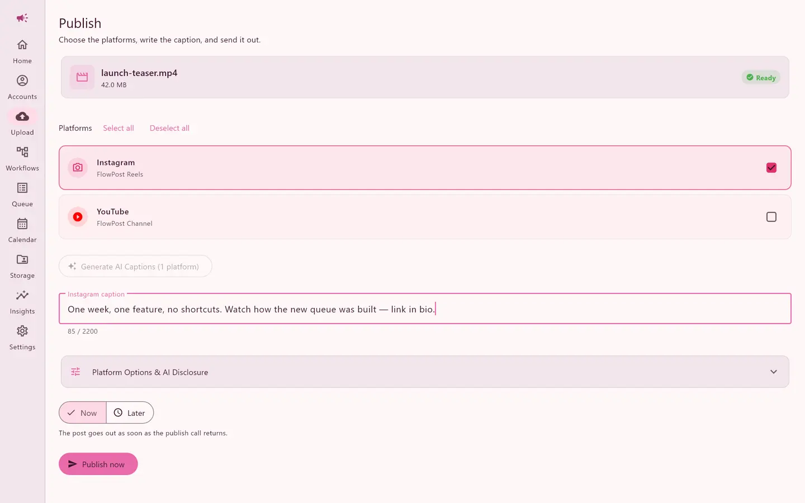
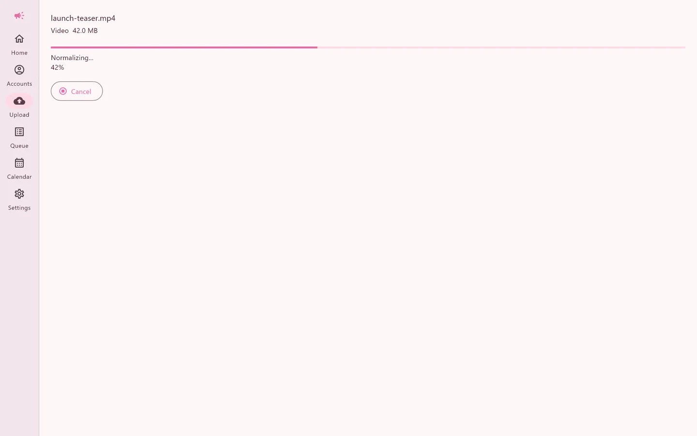
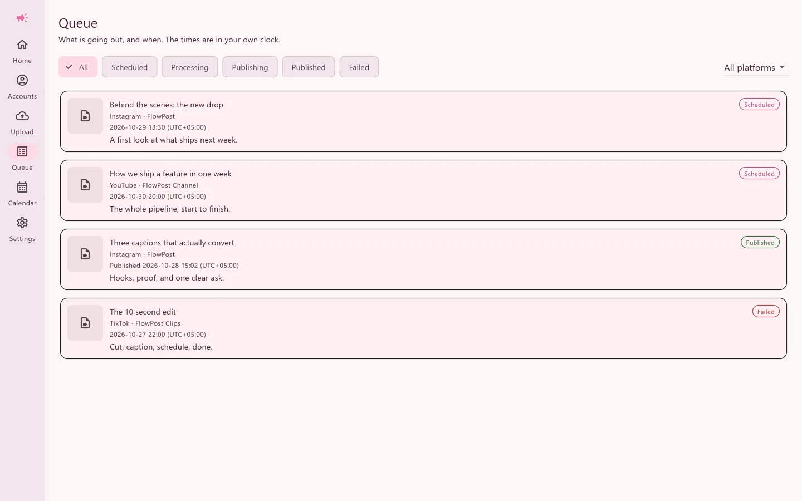
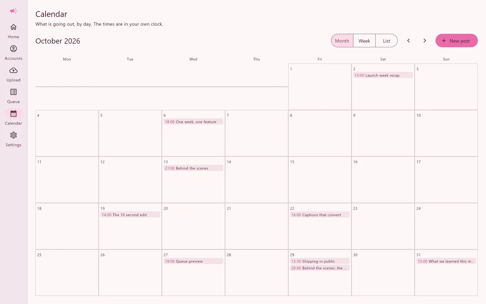
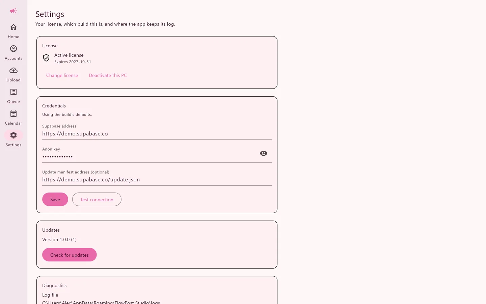
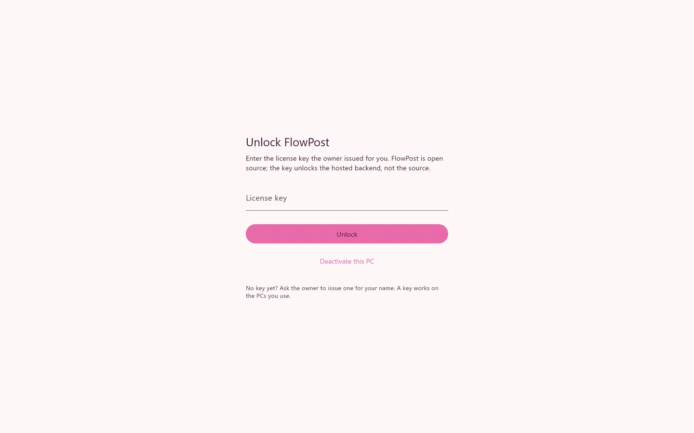

# FlowPost Studio

[](https://github.com/S-Q-Ali/flowpost-studio/actions/workflows/ci.yml)
[](LICENSE)
[](https://github.com/S-Q-Ali/flowpost-studio/releases/latest)

> Upload once, publish everywhere. A native Windows app for scheduling video and images to YouTube Shorts, Instagram Reels and Stories, Facebook Pages, TikTok and LinkedIn.

[Download for Windows](https://github.com/S-Q-Ali/flowpost-studio/releases/latest) · [Build from source](#build-from-source) · [How it works](#how-it-works)



## Features

- **Cross-platform publishing** — one upload fans out to YouTube, Instagram, Facebook, TikTok and LinkedIn
- **Scheduled posting** — pick a time per platform; a scheduler edge function publishes when it is due
- **Queue and calendar** — month, week and list views; edit, reschedule, retry or delete pending posts
- **AI captions** — Groq Whisper transcription, frame analysis and an LLM write per-platform captions
- **Accounts** — OAuth connections per platform, with tokens encrypted at rest
- **Offline-friendly** — posts cached in SQLite, drafts autosaved and restored after a restart
- **Desktop-native** — single instance, tray, allowlisted deep links, bundled FFmpeg and a diagnostics export
- **License-key access** — the app unlocks with a license key, with no account and no sign-up

## Screenshots

| | |
|---|---|
|  |  |
|  |  |
|  |  |

The images are rendered from the real widgets with fake data; `desktop-flutter/test/screenshots/capture.dart` regenerates them.

## Download

Installers are attached to [GitHub Releases](https://github.com/S-Q-Ali/flowpost-studio/releases/latest). Requirements: Windows 10 or 11 on x64. The installer is not code-signed, so SmartScreen may warn on the first run.

On first start the app asks for a license key — there is no login and no sign-up. The key is hashed and checked by the `verify-license` edge function, which mints a short-lived session; the key and session stay in the Windows credential vault and the app opens offline until the session expires. Settings → License deactivates the device.

## Build from source

Prerequisites:

- Flutter (stable channel) with the Windows desktop toolchain, on Windows 10 or 11
- The pinned FFmpeg build, fetched by the script below

```bash
cd desktop-flutter
flutter pub get
powershell -ExecutionPolicy Bypass -File tool\fetch_ffmpeg.ps1
flutter run -d windows
```

A build with no baked values opens a setup screen asking for the Supabase URL and anon key (and optionally the update manifest URL). The values are stored in `credentials.json` under `%APPDATA%\com.flowpost\FlowPost`; bake them in instead with `--dart-define=SUPABASE_URL=... --dart-define=SUPABASE_ANON_KEY=...`.

A source build still unlocks with a license key, so the backend it points at needs your key's hash in the `licenses` table.

Release build:

```bash
flutter build windows --release
```

The output is `desktop-flutter/build/windows/x64/runner/Release/`. FFmpeg is fetched, not committed; run the script once per checkout.

## How it works

| Part | Where | Stack |
|---|---|---|
| Windows desktop client | `desktop-flutter/` | Flutter (Windows), Riverpod, SQLite, bundled FFmpeg |
| Backend | `supabase/` | Supabase Postgres, Auth, Storage and Deno edge functions |
| Web dashboard | `src/` | React, TypeScript, Vite, Tailwind CSS, shadcn/ui, React Router |

The desktop client is the product here. The web dashboard is the browser view of the same backend: it signs in through Supabase (signups are closed; only an existing `public.users` row can sign in), and every privileged call still happens in an edge function.

## Getting started (web dashboard)

Prerequisites:

- Node.js (LTS) and npm
- A Supabase project with the migrations in `supabase/migrations/` applied
- Developer apps for the platforms you want to publish to

```bash
npm install
cp .env.example .env.local   # then fill in the VITE_ values
npm run dev                  # http://localhost:8080
```

The dashboard talks to Supabase through `VITE_SUPABASE_URL` and `VITE_SUPABASE_ANON_KEY`. Every privileged call happens in an edge function; the browser never holds a service-role key.

## Backend

### Deploy the edge functions

```bash
npx supabase login                       # or set SUPABASE_ACCESS_TOKEN
npx supabase link --project-ref <ref>
npx supabase functions deploy            # every function in supabase/functions
```

`supabase/config.toml` decides which functions accept unauthenticated calls. Most functions verify the caller themselves through `functions/_shared/auth.ts` (service role, cron key, frontend key, license session or an admin session token).

### Apply migrations

```bash
npx supabase db push
```

### Secrets

Set these in **Supabase Dashboard → Edge Functions → Secrets** (never in the repository):

| Variable | Purpose |
|---|---|
| `SUPABASE_URL` | Project URL |
| `SUPABASE_ANON_KEY` | Anon key, used to validate caller tokens |
| `SUPABASE_SERVICE_ROLE_KEY` | Server-side database access |
| `ALLOWED_ORIGIN` | Frontend origin allowed by CORS |
| `FRONTEND_API_KEY` | Key the dashboard sends on function calls |
| `CRON_API_KEY` | Key the scheduler sends |
| `APP_PASSWORD` | Legacy admin password gate |
| `TOKEN_ENCRYPTION_KEY` | 256-bit key for AES-GCM encryption of OAuth tokens |
| `GOOGLE_SHEET_ID` | Default sheet used by workflows |
| `FB_APP_ID`, `FB_APP_SECRET` | Facebook app |
| `IG_APP_ID`, `IG_APP_SECRET` | Instagram app |
| `YT_CLIENT_ID`, `YT_CLIENT_SECRET` | Google/YouTube OAuth client |
| `TIKTOK_CLIENT_KEY`, `TIKTOK_CLIENT_SECRET` | TikTok app |
| `LINKEDIN_CLIENT_ID`, `LINKEDIN_CLIENT_SECRET` | LinkedIn app |
| `GROQ_API_KEY` | Transcription, vision and caption generation |
| `R2_ENDPOINT`, `R2_ACCESS_KEY`, `R2_SECRET_KEY`, `R2_BUCKET`, `R2_PUBLIC_URL` | Cloudflare R2 workflow cache |

Local tooling reads `.env` (ignored by git). `ACCESS_TOKEN` there is a Supabase personal access token for the CLI only; it is never used by the app and `.env.example` keeps a placeholder.

## Scripts

Desktop commands live in `desktop-flutter/`:

| Command | What it does |
|---|---|
| `flutter run -d windows` | Run the client |
| `flutter build windows --release` | Release build |
| `flutter analyze lib test integration_test` | Static analysis |
| `dart format --set-exit-if-changed lib test integration_test` | Format gate |
| `flutter test` | Unit, provider and widget tests |
| `flutter test test/screenshots/capture.dart` | Regenerate the screenshots into `build/screenshots` |
| `flutter drive --profile -d windows --driver=test_driver/integration_test.dart --target=integration_test/perf_list_test.dart` | Windows performance harness |

Web scripts:

| Script | What it does |
|---|---|
| `npm run dev` | Vite dev server on port 8080 |
| `npm run build` | Production build |
| `npm run preview` | Serve the production build locally |
| `npm run lint` | ESLint over the dashboard |
| `npm run test` | Vitest (dashboard and `supabase/functions/_shared`) |
| `npm run test:watch` | Vitest in watch mode |

## Security

- License keys are stored as SHA-256 hashes and never in plain text; unlocking mints a short-lived session used by every desktop call
- The desktop app has no password path; the session and key sit in the Windows credential vault
- Row Level Security on every table; the browser only ever uses the anon key
- One shared authorizer (`functions/_shared/auth.ts`) for edge functions; owner checks via `resolveSessionOwner` and `checkPostAccess`
- OAuth tokens encrypted at rest (AES-GCM), OAuth state rows are random, single-use and expire
- Redirects are allowlisted (`//host` and `/\host` rejected); `get-file` only fetches Google hosts and its tokens expire
- Stored credentials are validated, masked and kept out of logs and diagnostics
- Deep links are allowlisted and logged without their query string; FFmpeg is started with an argument list, never a shell
- Signups are closed: only an existing `public.users` row can sign in
- No service-role key in either client

The reasoning behind each decision is in `docs/adr/`.

## Testing

```bash
cd desktop-flutter && flutter test        # Flutter unit, provider and widget tests
npm test                                  # Vitest: dashboard + edge function shared modules
```

## Documentation

- `docs/spec/` — feature specs and decisions
- `docs/adr/` — identity, FFmpeg bundling, local cache, credentials
- `docs/runbook.md` — support, release and rollback
- `USER_GUIDE.md` — end-user guide for the dashboard
- `CONTRIBUTING.md` — setup, the gates CI enforces, commit and pull request rules
- `SECURITY.md` — how to report a vulnerability privately
- `tasks/plan.md` and `tasks/todo.md` — roadmap and phase evidence

## Project layout

```
flowpost-studio/
├── desktop-flutter/         # Native Windows client
│   ├── lib/                 # App code (core, features, router)
│   ├── test/                # Unit, provider and widget tests
│   ├── integration_test/    # Windows performance harnesses
│   └── tool/                # fetch_ffmpeg.ps1
├── src/                     # Web dashboard (pages, components, hooks, Supabase client)
├── supabase/
│   ├── functions/           # Deno edge functions; shared code in functions/_shared/
│   └── migrations/          # SQL migrations, applied in order
├── docs/
│   ├── spec/                # Feature specs
│   ├── adr/                 # Architecture decision records
│   ├── screenshots/         # README images
│   └── runbook.md           # Support, release and rollback
├── tasks/                   # Plan, status and evidence
└── .env.example             # Environment template (copy to .env)
```

## License

MIT. See `LICENSE`. The copyright notice stays with the project owner.
