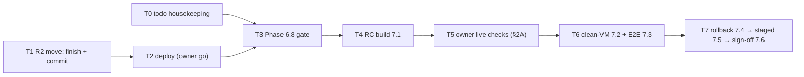

# FlowPost Desktop: status report and next plan (2026-11-08)

Sources: `tasks/todo.md`, `tasks/plan.md`, `tasks/todo-2026-11-01-audit-and-features.md`, `tasks/todo-2026-11-05-workflows.md`, `tasks/plan-2026-11-07-audit-fixes.md`, `git status/log`, `graphify query`.
Skills used: `using-agent-skills` (to choose the skill), `planning-and-task-breakdown` (for the plan).

## 1. Progress at a glance

| Area | Done | Remaining | % |
|---|---|---|---|
| **Code / features (desktop)** | Shell, license access, accounts (browser connect), media/FFmpeg, captions, R2 upload, publishing, scheduling/calendar/queue, offline cache + drafts, settings, diagnostics, dark mode, guided setup, accessibility | W4 desktop Workflows screen (v1.1 scope) | **~95%** |
| **Backend (Supabase)** | 32 functions deployed, migrations applied, audit fixes A1–A8 live | R2 secret move uncommitted (see §3) | **~95%** |
| **Verification / gates** | Unit, widget and integration tests, perf and security reviews | Live checkpoints + human approvals (list in §2) | **~55%** |
| **Release (Phase 7)** | `rebuild.bat`, installer script, runbook | 7.1–7.6 all open | **~10%** |
| **Overall (weighted)** | | | **≈ 80–85%** |

Checkbox count in `tasks/todo.md`: **219 done / 37 open (~86%)**. Most of the open items are verification and approval, not code.

> [!NOTE]
> `tasks/todo.md` Phase 1 (Google login/identity) is **superseded**. ADR 0006 replaced it with license-key access (L1–L12 done), and the identity module was deleted (decision D7). Phase 1's 13 open boxes are no longer real work. Mark them "superseded".

## 2. What is still pending

### A. Live checks only the owner can do (on the installed build)
| # | Item | Source |
|---|---|---|
| 1 | L11b: unlock with the license key, then restart offline, let the session expire, and confirm the log shows no key | todo.md L11b, `deploy-server-68.md` steps 6–9 |
| 2 | C4/F7: connect → close the browser → publish (Instagram connect was fixed live on 11-07; publish still needs proof) | 11-01 todo |
| 3 | Phase 4 gate: **one real platform publish** (feed + story, publish-now + scheduled) | todo.md 4.5, audit-fixes checkpoint 3 |
| 4 | D5: walk every screen in light and dark on the installed build | 11-01 todo |
| 5 | E7: clean `%APPDATA%` → wizard → usable (both tracks) | 11-01 todo |
| 6 | Wedged posts: 263 `processing` + 74 `publishing` rows need a decision for each row | audit-fixes, runbook |
| 7 | Workflows: check `workflow_runs` after a due tick | workflows todo |

### B. Owner decisions and approvals
- Phase 3 gate plus approval of the FFmpeg/LGPL ADR 0002 (and whether to add an About/attribution screen).
- Phase 2, 3, 4 and 6 gate approvals (the evidence is already written up).
- **Rotate the credentials in git history** (R2, IG, FB, YouTube, Gemini, GCP SA). This is a security P0 before release.
- A second person builds the app from the README.
- Verify the commit email on GitHub; confirm the live `workflows` columns match the migrations.

### C. Engineering work left (the agent can do these)
1. **Uncommitted work in progress:** `_shared/r2.ts` (+ test) and the move of `google-drive-auth` and `process-workflow` to the guided-setup R2 read (Phase E3 follow-up). Tests: `r2.test.ts` 4 and `secrets.test.ts` 9 pass. Still to do: Deno check, review, commit, deploy (needs the owner's go).
2. Phase 6.8 gate: `shipping-and-launch` checklist + scoped `ponytail-audit`.
3. Phase 7.1: version bump, release build, installer, checksum, release notes.
4. Housekeeping: mark Phase 1 in `tasks/todo.md` as superseded and tick the finished Phase 2 gate box.
5. Nine `graph.facebook.com/v23.0` strings in `facebook-auth`. They were left on purpose; move them once a live connect proves the change.

### D. Not started (needs a separate go, v1.1)
- W3 named workflow stages, W4 desktop Workflows screen (read-only), Meta token renewal.

## 3. Next plan (in task order)

### T0: Todo housekeeping (XS)
- **Acceptance:** Phase 1 in `tasks/todo.md` is marked "superseded by ADR 0006 / license track"; the finished 2.5 gate is ticked; this report is linked.
- **Verify:** grep shows the open boxes are only real work.

### T1: Finish the R2 guided-setup move (S)
- **Acceptance:** `google-drive-auth` and `process-workflow` read R2 through `readR2Config` on every request; a missing key returns a readable `SecretProblem`; `process-workflow` keeps no `Deno.env.get("R2_*")` reads (currently 0).
- **Verify:** `npx vitest run supabase/functions` green; `deno check --no-lock` over the functions passes with 0 errors; `npm run lint` shows 0 errors; `/ponytail-review` on the diff.
- **Files:** `_shared/r2.ts`, `_shared/r2.test.ts`, the 2 functions. One commit, then `graphify update .`.

### T2: Deploy both functions (XS, **owner go required**)
- **Verify:** both ACTIVE on read-back; an unauthenticated POST returns 401; one scheduled workflow tick uploads to R2.

### T3: Phase 6.8 gate (S)
- `flutter analyze`, format, `flutter test`, integration test, release build; `shipping-and-launch` checklist; scoped `ponytail-audit` with no Must-fix.
- **Exit:** owner approval.

### T4: Release candidate, 7.1 (S)
- Version bump in `pubspec.yaml`, `rebuild.bat` → setup exe + portable zip, SHA-256, release notes (unsigned, manual update, no offline publish).

### T5: Owner live checks (§2A items 1–5)
- The agent writes a single checklist doc; the owner runs it on the installed RC; the evidence goes into `tasks/todo.md`.

### T6: Clean-VM install + end-to-end smoke (7.2, 7.3)
### T7: Rollback (7.4) → staged release with one week of monitoring (7.5) → final audit and sign-off (7.6)

## Risks
| Risk | Impact | Mitigation |
|---|---|---|
| Credentials in git history are still live | High | Rotate before 7.1 (owner) |
| 337 wedged posts on a live status | Med | Decide per row using the runbook query |
| No real publish has been proven end to end on desktop | High | T5 item 3 before RC sign-off |
| `flutter test` was not re-run in this session (the sandbox run hung) | Low | Run it as part of T3 |

## Open questions for the owner
1. Should T1 (R2 move) be committed and deployed now?
2. Is the W4 desktop Workflows screen in v1, or does it stay v1.1?
3. Can you run the live checks (L11b, real publish, connect→publish) this week?
